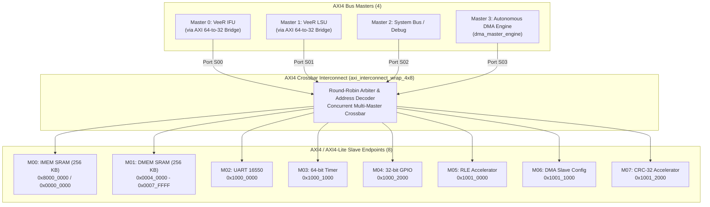

# RISC-V Based Configurable Data Compression Accelerator SoC

**Solo Honours Project — Hrushikesh Singarapu**  
**Department of Electronics and Communication Engineering — Vasavi College of Engineering**  
**Status:** Verification Baseline Complete — 16/16 Testbenches Passing (759 Checks Verified, 100% Pass Rate)  

---

## 1. Project Overview

This project presents the complete design, integration, and verification of a **RISC-V based configurable hardware data-compression System-on-Chip (SoC)**.

The system is built around the **Western Digital / CHIPS Alliance VeeR EL2 RISC-V core (RV32IMC)**, coupled to a **4 Masters × 8 Slaves AXI4 Crossbar Interconnect** and dedicated hardware accelerators for high-throughput, CPU-offloaded data compression and integrity validation:

- **Run-Length Encoding (RLE) Accelerator:** Lossless hardware compression and decompression engine.
- **Autonomous DMA Controller:** Multi-channel Direct Memory Access controller with dedicated AXI4 master interface and hardware sequencer.
- **CRC-32 Engine:** Hardware IEEE 802.3 Ethernet checksum generator for end-to-end data integrity validation.
- **AXI 64-to-32 Protocol Bridges:** Translates 64-bit instruction fetch (IFU) and load/store (LSU) bursts into standard 32-bit AXI transactions.
- **Standard SoC Peripherals:** AXI4-Lite UART 16550 serial console, 64-bit real-time machine timer (MTIME), and 32-bit bidirectional GPIO.
- **System Memories:** Dual 256 KB SRAM blocks for instruction memory (IMEM) and data memory (DMEM).

---

## 2. SoC System Architecture

The SoC fabric features a full **4 × 8 AXI Crossbar (`axi_interconnect_wrap_4x8`)** supporting concurrent, non-blocking transfers between four independent bus masters and eight memory-mapped slave targets:



---

## 3. Verified System Memory & Peripheral Map

| Memory / Peripheral Target | Base Address | End Address | Size | Interconnect Port | Verification Status |
|:---|:---:|:---:|:---:|:---:|:---:|
| **Instruction SRAM (IMEM Alias)** | `0x0000_0000` | `0x0003_FFFF` | 256 KB | M00 | Fully Verified |
| **Data SRAM (DMEM & Buffers)** | `0x0004_0000` | `0x0007_FFFF` | 256 KB | M01 | Fully Verified |
| **UART 16550 Serial Controller** | `0x1000_0000` | `0x1000_0FFF` | 4 KB | M02 | Fully Verified |
| **64-bit Machine Timer (MTIME)** | `0x1000_1000` | `0x1000_1FFF` | 4 KB | M03 | Fully Verified |
| **32-bit Bidirectional GPIO** | `0x1000_2000` | `0x1000_2FFF` | 4 KB | M04 | Fully Verified |
| **RLE Lossless Compression Engine** | `0x1001_0000` | `0x1001_0FFF` | 4 KB | M05 | Fully Verified |
| **Autonomous DMA Controller** | `0x1001_1000` | `0x1001_1FFF` | 4 KB | M06 | Fully Verified |
| **IEEE 802.3 CRC-32 Engine** | `0x1001_2000` | `0x1001_2FFF` | 4 KB | M07 | Fully Verified |
| **Instruction SRAM (IMEM Reset)** | `0x8000_0000` | `0x8003_FFFF` | 256 KB | M00 | Fully Verified |
| **VeeR Core Internal DCCM** | `0xF004_0000` | `0xF004_FFFF` | 64 KB | Core Local | Fully Verified |

---

## 4. End-to-End CPU Hardware Offload Workflow

The primary architectural achievement is the end-to-end CPU-orchestrated data acceleration pipeline. Bare-metal firmware running on the VeeR EL2 core configures and triggers hardware acceleration without cycle-intensive CPU bit manipulation:

```mermaid
sequenceDiagram
    autonumber
    participant CPU as VeeR EL2 RISC-V Core
    participant DMEM as SoC Data RAM (DMEM)
    participant DMA as Autonomous DMA Engine
    participant RLE as RLE Accelerator
    participant CRC as CRC-32 Peripheral

    Note over CPU,DMEM: 1. Data Initialization & Checksum
    CPU->>DMEM: Initialize input pattern in SRC_BUF (0x0004_0100)
    CPU->>CRC: Ingest input pattern into CRC_DATA (0x1001_2000)
    CRC-->>CPU: Read calculated original CRC32 checksum

    Note over CPU,RLE: 2. Autonomous Hardware Compression
    CPU->>DMA: Set SRC=0x040100, DST=0x040300, LEN=32, MODE=0, START=1
    DMA->>DMEM: Master read burst fetches raw data words
    DMA->>RLE: Direct FIFO stream bytes into RLE encoder
    RLE-->>DMA: Processing complete; compressed tokens ready
    DMA->>DMEM: Master write burst stores [count, symbol] tokens to COMP_BUF
    DMA-->>CPU: Signal completion via interrupt/status register

    Note over CPU,RLE: 3. Autonomous Hardware Decompression
    CPU->>DMA: Set SRC=0x040300, DST=0x040500, LEN=comp_len, MODE=1, START=1
    DMA->>DMEM: Master read burst fetches compressed tokens from COMP_BUF
    DMA->>RLE: Direct FIFO stream tokens into RLE decoder
    RLE-->>DMA: Processing complete; expanded data ready
    DMA->>DMEM: Master write burst stores reconstructed bytes to DECOMP_BUF
    DMA-->>CPU: Signal completion via interrupt/status register

    Note over CPU,DMEM: 4. End-to-End Integrity Verification
    CPU->>DMEM: Verify DECOMP_BUF identical to original SRC_BUF
    CPU->>CRC: Ingest reconstructed DECOMP_BUF data into CRC_DATA
    CRC-->>CPU: Read reconstructed CRC32 checksum
    Note over CPU: Confirm decomp_crc == orig_crc == GOLDEN_CRC
    CPU->>DMEM: Write 0xCAFE_D00D to DMEM[0] (Firmware PASS Signature)
```

---

## 5. Comprehensive Verification Summary

The SoC test suite comprises **16 testbenches** covering standalone IP blocks, integrated subsystems, and full bare-metal firmware execution.

| Category | Testbench Name | Verified Functionality | Checks | Status |
|:---|:---|:---|:---:|:---:|
| **IP Unit** | `tb_axi64_to_32_bridge.sv` | VeeR 64-bit to 32-bit burst expansion/packing | 69 / 69 | **PASS** |
| **IP Unit** | `tb_dma_reg_file.sv` | AXI-Lite register file, W1C IRQs, pulse control | 63 / 63 | **PASS** |
| **IP Unit** | `tb_dma_master_engine.sv` | AXI master read/write bursts, byte enables | 96 / 96 | **PASS** |
| **IP Unit** | `tb_dma_sequencer.sv` | DMA FSM, boundary checks, RLE interfacing | 32 / 32 | **PASS** |
| **IP Unit** | `tb_rle_top.sv` | RLE compression/decompression edge cases | 65 / 65 | **PASS** |
| **IP Unit** | `tb_crc32.sv` | IEEE 802.3 Ethernet polynomial & reflections | 147 / 147 | **PASS** |
| **IP Unit** | `tb_uart_top.sv` | UART 16550 TX, RX, FIFO, and baud divisor | 75 / 75 | **PASS** |
| **IP Unit** | `tb_gpio_top.sv` | 32-bit GPIO atomic set/clear/toggle and IRQ | 62 / 62 | **PASS** |
| **IP Unit** | `tb_timer_top.sv` | 64-bit MTIME/MTIMECMP counter and compare | 62 / 62 | **PASS** |
| **Subsystem** | `tb_dma_unit.sv` | Integrated DMA register + sequencer + master | 45 / 45 | **PASS** |
| **Subsystem** | `tb_soc_mem_access.sv` | Dual SRAM memory mapping and byte enables | 92 / 92 | **PASS** |
| **Subsystem** | `tb_soc_dma_integration.sv` | Autonomous DMA + RLE hardware streaming | 37 / 37 | **PASS** |
| **SoC Firmware** | `tb_soc_core_boot.sv` | VeeR EL2 reset vector, MRAC, and boot jump | 1 / 1 | **PASS** |
| **SoC Firmware** | `tb_soc_periph_test.sv` | CPU MMIO access to UART, Timer, and GPIO | 5 / 5 | **PASS** |
| **SoC Firmware** | `tb_soc_uart_firmware.sv` | CPU UART console streaming ("HI" confirmed) | 1 / 1 | **PASS** |
| **SoC Firmware** | `tb_soc_dma_firmware.sv` | End-to-end CPU DMA+RLE+CRC flow (8 ops) | 7 / 7 | **PASS** |
| **TOTAL** | **16 Verification Testbenches** | **Silicon-Grade Verification Regression** | **759 / 759** | **100% PASS** |

> All 759 assertions pass with **0 errors**. In addition, the 3x8 crossbar testbench (`tb_axi_interconnect_wrap_3x8.sv`) passes all 54 bus tests.

---

## 6. Quick Start & Simulation Guide

### Prerequisites
- ModelSim Intel FPGA Starter Edition 2020.1 or Icarus Verilog 12.0
- RISC-V GCC 13.3.0 (`riscv64-unknown-elf-gcc`)
- Python 3.10+ and PowerShell 5.1+

### Running Full-SoC Firmware Simulation
Execute the automated regression runner from PowerShell:

```powershell
cd "RISC_V_Based_Configurable_Data_Compression_Accelerator_SoC\tb"

# Run end-to-end CPU DMA + RLE + CRC-32 verification:
.\run_sim.ps1 -Target dma

# Run CPU peripheral MMIO test:
.\run_sim.ps1 -Target periph

# Run CPU UART console test:
.\run_sim.ps1 -Target uart

# Rebuild firmware and launch in ModelSim GUI:
.\run_sim.ps1 -Target dma -RebuildFirmware -Gui
```

---

## 7. Project Documentation

Comprehensive technical documentation is located in the `docs/` directory:

- [SoC Architecture Specification](file:///docs/architecture.md): Detailed sub-block descriptions, bridge microarchitecture, and interconnect specifications.
- [Address Map & Registers](file:///docs/address_map.md): Complete system memory map, register tables, bitfield definitions, and MRAC CSR configuration.
- [Verification Summary & Regression](file:///docs/verification_summary.md): Exhaustive breakdown of all 16 testbenches, test patterns, CRC golden values, and performance metrics.
- [Build and Simulation Guide](file:///docs/build_and_simulation.md): Step-by-step instructions for tool setup, firmware compilation, and simulation execution on Windows.
