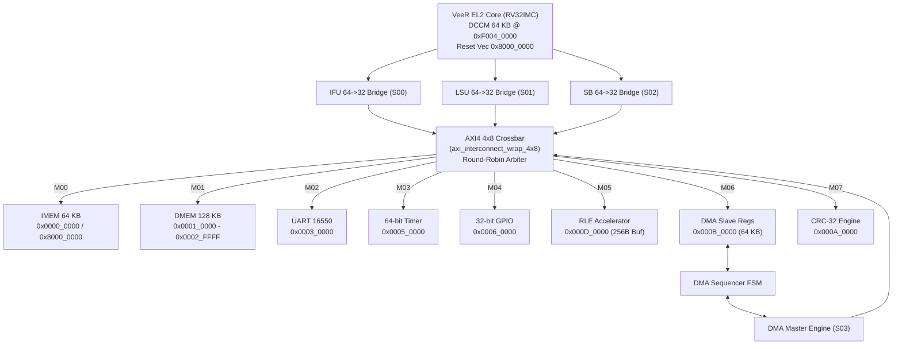

# RISC-V Based Configurable Data Compression Accelerator SoC

[](https://riscv.org/technical/specifications/)
[](https://github.com/chipsalliance/Cores-VeeR-EL2)
[]()
[](docs/verification/verification.md)

**Department of Electronics and Communication Engineering — Vasavi College of Engineering**

A configurable hardware-accelerated data compression System-on-Chip built around the CHIPS Alliance **VeeR EL2 (RV32IMC)** RISC-V processor, connected over a 4-master x 8-slave AXI4 crossbar (`axi_interconnect_wrap_4x8`) to instruction/data memories, autonomous DMA, lossless Run-Length Encoding (RLE), IEEE 802.3 CRC-32, UART, Timer, and GPIO peripherals.

- **Address Map & Register Specification:** [`docs/architecture/address_map.md`](docs/architecture/address_map.md) (authoritative Excel baseline: [`archive/phase1/Full_Soc_Address_Map.xlsx`](archive/phase1/Full_Soc_Address_Map.xlsx))
- **Architecture Block Diagram (PDF):** [`docs/architecture/riscv_rle_soc_arch.pdf`](docs/architecture/riscv_rle_soc_arch.pdf)
- **Verification Testplan, Coverage & Results:** [`docs/verification/verification.md`](docs/verification/verification.md)

---

## 1. SoC Architecture



### Integrated Components

| Block | Module / File | Role & Key Details |
|---|---|---|
| **Processor Core** | [`rtl/soc/soc_core_top.sv`](rtl/soc/soc_core_top.sv) | CHIPS Alliance VeeR EL2 (`RV32IMC`), 64 KB internal ICCM/DCCM, `rst_vec = 0x8000_0000` |
| **Bus Adaptation** | [`rtl/interconnect/axi64_to_32_bridge.v`](rtl/interconnect/axi64_to_32_bridge.v) | Converts VeeR 64-bit `IFU`/`LSU`/`SB` channels into 32-bit AXI4 transfers with lane strobes |
| **AXI4 Crossbar** | [`rtl/interconnect/axi_interconnect_wrap_4x8.v`](rtl/interconnect/axi_interconnect_wrap_4x8.v) | 4 masters (`S00`–`S03`) x 8 slaves (`M00`–`M07`), `M_REGIONS=2`, unmapped addresses return `DECERR` |
| **Memories** | [`rtl/soc/soc_top.v`](rtl/soc/soc_top.v) (`soc_sram`) | 64 KB IMEM (`0x0000_0000`, `0x8000_0000` alias) and 128 KB DMEM (`0x0001_0000`–`0x0002_FFFF`) |
| **DMA Controller** | [`rtl/accelerators/dma/`](rtl/accelerators/dma/dma_top.v) | AXI4-Lite slave config + autonomous AXI4 master (`S03`) moving 1–256 B between DMEM & RLE (`dma_irq`) |
| **RLE Engine** | [`rtl/accelerators/rle/`](rtl/accelerators/rle/rle_top.v) | Lossless `[count, symbol]` encoder/decoder, `BUFFER_DEPTH=256` in SoC, max run 255 (`rle_irq`) |
| **CRC-32 Engine** | [`rtl/peripherals/crc/crc32_top.v`](rtl/peripherals/crc/crc32_top.v) | IEEE 802.3 (`0xEDB88320`) combinational checksum with byte-strobe (`wstrb`) ingestion |
| **UART / Timer / GPIO** | [`rtl/peripherals/`](rtl/peripherals/uart/axi_uart_top.v) | Direct-divisor UART (CPU polling on `LSR`), 64-bit `MTIME` (`timer_irq`), 32-bit atomic/IRQ GPIO (`gpio_irq`) |

Reserved address slots specified in `Full_Soc_Address_Map.xlsx` (`Packet FIFO`, `Packet Counter`, `Enhanced Timer`, `External Interrupt Controller`, and `Future Expansion Bank A`) are intentionally unimplemented and return `DECERR` (`2'b11`). See [`docs/architecture/address_map.md`](docs/architecture/address_map.md) for the complete memory map, MRAC CSR `0x7C0` (`0x5555_5556`) setup, and register definitions.

---

## 2. Repository Structure

```text
RISC_V_Based_Configurable_Data_Compression_Accelerator_SoC/
├── README.md
├── docs/
│   ├── architecture/
│   │   ├── address_map.md          # Complete authoritative memory & register map
│   │   └── riscv_rle_soc_arch.pdf  # SoC block diagram & integration reference
│   └── verification/
│       └── verification.md         # Verification methodology, testplan, results & limitations
├── rtl/
│   ├── soc/                        # soc_top.v, soc_core_top.sv
│   ├── interconnect/               # axi_interconnect.v, wrap_4x8, axi64_to_32_bridge.v, arbiter.v
│   ├── peripherals/                # uart/, timer/, gpio/, crc/
│   └── accelerators/               # dma/, rle/
├── firmware/
│   ├── startup/start.S             # Reset vector handler, MRAC CSR 0x7C0 = 0x5555_5556, stack setup
│   ├── linker/linker.ld            # IMEM @ 0x8000_0000 (64K), DMEM @ 0x0001_0000 (128K), DCCM @ 0xF004_0000
│   ├── source/                     # main.c, main_dma.c, uart_echo.c, soc_e2e_uvm.c, soc_decerr_test.c
│   └── images/                     # Precompiled 32-bit word HEX / VH payloads for $readmemh
├── verification/
│   ├── uvm/                        # Integrated 4-agent SoC UVM 1.2 env (UART, GPIO, Reset, IRQ + soc_obs_if)
│   ├── assertions/                 # AXI4, AXI4-Lite, DMA, RLE, and SoC protocol assertion checkers
│   ├── standalone/                 # Unit, interconnect (tb_axi_interconnect_4x8), audit & firmware testbenches
│   └── legacy/                     # Preserved Phase-0 3x8 interconnect testbench (inactive)
├── tb/
│   ├── vip/                        # Standalone reusable module VIP sanity testbench
│   ├── uvm/                        # Separate IP-level RLE & DMA UVM 1.2 environments
│   └── run_uvm_regression.ps1      # Standalone IP UVM & VIP PowerShell runner
├── simulation/
│   ├── filelists/                  # Top simulation filelists
│   ├── scripts/
│   │   ├── run_full_regression.ps1 # Unified Windows ModelSim regression across all verification layers
│   │   ├── run_sim.ps1             # VeeR firmware runner (-Target boot|periph|uart|dma_firmware|all)
│   │   └── run_soc_uvm.sh          # Linux Synopsys VCS SoC UVM + coverage runner
│   └── waveforms/                  # GTKWave config and waveform SVG/PNG renders
├── scripts/                        # Firmware HEX generators and VCD waveform utilities
├── third_party/RISC-V-VeeR-EL2/    # External CHIPS Alliance VeeR EL2 RTL & soc_sim snapshot headers
└── archive/                        # Authoritative Full_Soc_Address_Map.xlsx & historical project files
```

---

## 3. Build & Simulation Guide

### 3.1 Prerequisites
- **RTL Simulation (Windows):** ModelSim Intel FPGA Starter Edition `2020.1` (`vlog`, `vsim`, `vlib`, `vmap` on `PATH` or default `C:\intelFPGA\20.1\modelsim_ase\win32aloem`).
- **RTL Simulation (Linux UVM + Native Covergroups):** Synopsys `vcs` (`VCS_HOME` / `SNPSLMD_LICENSE_FILE` configured in environment).
- **Bare-Metal Firmware Rebuild (Optional — prebuilt `.hex` images are committed):** `riscv64-unknown-elf-gcc` (13.x+, `-march=rv32imc_zicsr_zifencei`) + `riscv64-unknown-elf-objcopy` + Python 3.10+.

### 3.2 Unified Regression Runner (Windows ModelSim)

Run individual suites or all layers from the SoC root (`RISC_V_Based_Configurable_Data_Compression_Accelerator_SoC/`):

```powershell
# Run all default suites (standalone, interconnect, vip, rle_uvm, dma_uvm, firmware, soc_uvm)
.\simulation\scripts\run_full_regression.ps1 -Suite all -Seed 12345

# Run specific layers individually:
.\simulation\scripts\run_full_regression.ps1 -Suite standalone
.\simulation\scripts\run_full_regression.ps1 -Suite interconnect
.\simulation\scripts\run_full_regression.ps1 -Suite firmware
.\simulation\scripts\run_full_regression.ps1 -Suite soc_uvm

# Optionally include long 115200-baud interactive tests (soc_smoke_test ~6.5m, uart_echo_test ~23m est.)
.\simulation\scripts\run_full_regression.ps1 -Suite soc_uvm -IncludeLongUvm
```

Other focused runners:
- **Standalone IP UVM & VIP:** `cd tb; .\run_uvm_regression.ps1 -Target all`
- **VeeR Firmware Suite:** `.\simulation\scripts\run_sim.ps1 -Target all`
- **Linux Synopsys VCS SoC UVM:** `./simulation/scripts/run_soc_uvm.sh all`

### 3.3 Rebuilding Bare-Metal Firmware Images

```powershell
cd firmware
riscv64-unknown-elf-gcc -march=rv32imc_zicsr_zifencei -mabi=ilp32 -O2 -nostartfiles `
  -T linker/linker.ld -o images/fw.elf startup/start.S source/main_dma.c
riscv64-unknown-elf-objcopy -O binary -j .text images/fw.elf images/fw.bin
python -c "import struct; d=open('images/fw.bin','rb').read(); d+=b'\x00'*((-len(d))%4); open('images/dma_test_word.hex','w').writelines(f'{u:08x}\n' for (u,) in struct.iter_unpack('<I',d))"
```

*(Use relative output names inside `firmware/` if the repository path contains spaces to avoid GNU `ld` path-splitting issues.)*

---

## 4. Verification Status Summary (RTL Simulation Only)

All checks are verified in RTL simulation (no FPGA synthesis, timing closure, or board-level testing is claimed). Detailed testbench tables, protocol assertion summaries, fixed bugs, and simulator constraints are documented in [`docs/verification/verification.md`](docs/verification/verification.md):

- **Standalone IP & SoC Hardware (`13/13` TBs):** `1,059 / 1,059` checks passing across DMA, RLE, CRC-32, UART, GPIO, Timer, 64->32 bridge, memory/reset-vector access, DMA integration, and exhaustive address-map audit (`tb_soc_address_map_audit`, `111/111`).
- **4x8 AXI4 Interconnect Stress:** `99 / 99` checks, `16 / 16` functional coverage bins (`100.0%`), `0` AXI4 protocol assertion errors.
- **IP UVM 1.2 & VIP Suites:** `tb_vip_sanity` (`7/7`), `tb_rle_uvm` (`14/14` txns, `11/11` bins `100.0%`), `tb_dma_uvm` (`15/15` xfers, `12/12` bins `100.0%`).
- **VeeR EL2 Firmware (`4/4`):** `tb_soc_core_boot`, `tb_soc_periph_test`, `tb_soc_uart_firmware`, `tb_soc_dma_firmware` (`0xCAFED00D`, 8 DMA xfers, 4 CRC-32 golden patterns).
- **Integrated 4-Agent SoC UVM (`tb_soc_top`):** `soc_decerr_trap_test`, `soc_e2e_flow_test`, `soc_reset_recovery_test`, and `soc_smoke_test` passing with `UVM_ERROR=0`, `UVM_FATAL=0`, `TOTAL=0` protocol assertion errors, and `25 / 25` (`100.0%`) aggregated functional coverage counters across the three core tests (`uart_echo_test` deferred to `-IncludeLongUvm` / VCS due to ~23 min 115200-baud runtime in ModelSim Starter Edition).

---

## 5. Author & License

**Author:** Hrushikesh Singarapu — Department of ECE, Vasavi College of Engineering
*(Third-party VeeR EL2 RTL remains under `third_party/RISC-V-VeeR-EL2/` with its original Apache 2.0 license.)*
