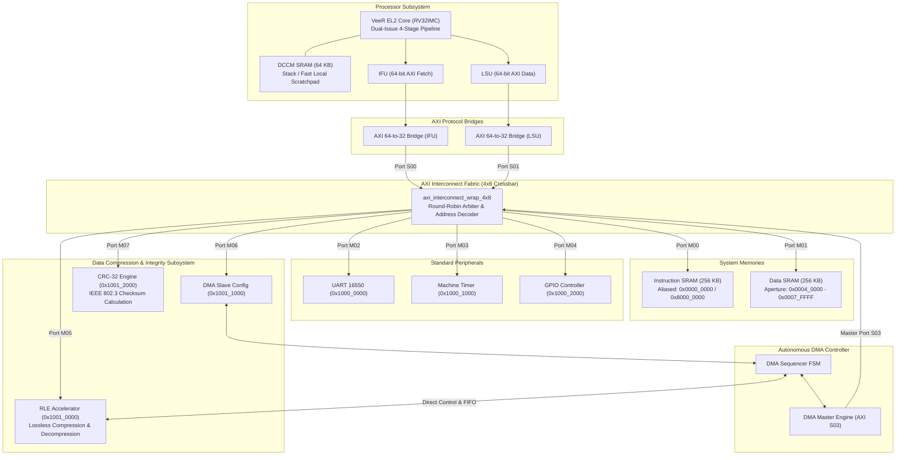

# SoC Architecture Specification

**Project:** RISC-V Based Configurable Data Compression Accelerator SoC  
**Processor Core:** Western Digital / CHIPS Alliance VeeR EL2 (RV32IMC)  
**Interconnect:** AXI4 Multi-Master / Multi-Slave Crossbar (4 Masters × 8 Slaves)  
**Hardware Accelerators:** Autonomous DMA Controller, RLE Compression Engine, IEEE 802.3 CRC-32 Engine  

---

## 1. System Overview

The SoC integrates a high-performance 32-bit RISC-V processor core with dedicated hardware acceleration blocks to enable high-throughput, CPU-offloaded data compression, decompression, and integrity verification.



---

## 2. Processor Core Subsystem

### 2.1 VeeR EL2 RISC-V Core
- **Architecture:** RV32IMC (32-bit RISC-V with Integer, Multiply/Divide, and Compressed 16-bit instruction support).
- **Pipeline:** Dual-issue, 4-stage in-order execution pipeline.
- **Local Memory:** 64 KB closely coupled Data Memory (DCCM) mapped to `0xF004_0000`–`0xF004_FFFF`. Used primarily for execution stack (`sp = 0xF004_FFF0`) and local variables.
- **Reset Vector:** Configured to `0x8000_0000` (`rst_vec = 31'h4000_0000`).
- **Memory Region Attributes (MRAC CSR `0x7C0`):**
  - Configured to `0x5555_555A` upon reset in `start.S`.
  - Region 0 (`0x0000_0000`–`0x0FFF_FFFF`): Non-cacheable, side-effect safe (DMEM).
  - Region 1 (`0x1000_0000`–`0x1FFF_FFFF`): Non-cacheable, side-effect (MMIO peripherals).
  - Region 8 (`0x8000_0000`–`0x8FFF_FFFF`): Cacheable, idempotent (IMEM reset vector).

### 2.2 AXI 64-to-32 Bridges
The VeeR core issues 64-bit AXI transactions on both IFU and LSU. The `axi64_to_32_bridge` modules perform:
1. **64-bit Read Burst Expansion:** Deconstructs a 64-bit IFU fetch beat into a 2-beat 32-bit INCR burst (`arsize = 2'b10, arlen = 1`), packs returning data words, and returns 64-bit response `{Beat1, Beat0}`.
2. **64-bit Write Burst Splitting:** Deconstructs 64-bit writes into 2 sequential 32-bit writes with precise byte write strobes (`wstrb`).
3. **Decoupled AW/W Channels:** Buffers write addresses and data independently to accommodate out-of-order handshakes.

---

## 3. AXI Crossbar Interconnect (`axi_interconnect_wrap_4x8`)

The interconnect is a full crossbar supporting simultaneous non-conflicting transfers across 4 masters and 8 slaves:

### Interconnect Port Matrix

| Port | Direction | Entity | Width | Protocol | Role in System |
|:---:|:---:|:---|:---:|:---:|:---|
| **S00** | Slave In | IFU Bridge | 32-bit | AXI4 Full | Instruction fetches from CPU |
| **S01** | Slave In | LSU Bridge | 32-bit | AXI4 Full | Data load/store from CPU |
| **S02** | Slave In | System Bus (SB) | 32-bit | AXI4 Full | Debug and external DMA master |
| **S03** | Slave In | DMA Master Engine | 32-bit | AXI4 Full | Autonomous DMA memory reads and writes |
| **M00** | Master Out | IMEM SRAM | 32-bit | AXI4-Lite | Instruction memory (256 KB) |
| **M01** | Master Out | DMEM SRAM | 32-bit | AXI4-Lite | Data memory & accelerator buffers (256 KB) |
| **M02** | Master Out | UART 16550 | 32-bit | AXI4-Lite | Serial communication & logging |
| **M03** | Master Out | Timer | 32-bit | AXI4-Lite | Machine timer peripheral |
| **M04** | Master Out | GPIO | 32-bit | AXI4-Lite | General purpose I/O |
| **M05** | Master Out | RLE Accelerator | 32-bit | AXI4-Lite | Data compression/decompression core |
| **M06** | Master Out | DMA Slave Interface | 32-bit | AXI4-Lite | DMA configuration register file |
| **M07** | Master Out | CRC-32 Engine | 32-bit | AXI4-Lite | IEEE 802.3 checksum peripheral |

---

## 4. Hardware Accelerator IP Blocks

### 4.1 DMA Subsystem
The DMA controller consists of three tightly coupled modules:
1. **`dma_reg_file.v` (AXI Slave):**
   - Exposes memory-mapped control and configuration registers (`0x1001_1000`–`0x1001_1020`).
   - Self-clearing `START` and `ABORT` pulse generation.
   - Sticky `DONE` and `ERROR` interrupt status with Write-1-to-Clear (W1C) semantics.
2. **`dma_sequencer.v` (Sequencer FSM):**
   - Validates parameters (source and destination must be inside DMEM `0x0004_0000`–`0x0007_FFFF`, length 1–256 bytes).
   - In compression mode (`MODE = 0`): Reads source bytes from DMEM, streams bytes to RLE input FIFO, starts RLE, waits for completion, reads compressed tokens, and packs them into words written to destination DMEM.
   - In decompression mode (`MODE = 1`): Reads compressed tokens from DMEM, streams them to RLE decoder, waits for completion, reads expanded bytes, and writes them to destination DMEM.
3. **`dma_master_engine.v` (AXI Master S03):**
   - Generates single-beat and multi-beat AXI4 bursts targeting DMEM.
   - Supports precise byte-enable write strobes (`wstrb`) for unaligned and partial-word transfers.

### 4.2 Run-Length Encoding (RLE) Accelerator
- **Algorithm:** Lossless run-length compression/decompression encoding sequences of identical bytes into `[count, symbol]` pairs.
- **Maximum Run:** 255 bytes per token. Runs longer than 255 are automatically split into multiple tokens.
- **Modes:** Software or DMA selectable via `REG_CONTROL` (Bit 1: `0 = Compress`, `1 = Decompress`).

### 4.3 CRC-32 Peripheral
- **Polynomial:** IEEE 802.3 Ethernet 32-bit polynomial: `0xEDB88320` (bit-reversed representation of `0x04C11DB7`).
- **Initial Seed & XOR:** Initial accumulator seed `0xFFFFFFFF`, final inverted output (`accum ^ 0xFFFFFFFF`).
- **Data Ingestion:** Supports 32-bit word writes and partial byte strobes (`wstrb`) at base address `0x1001_2000`.

---

## 5. End-to-End CPU-Controlled Acceleration Flow

```mermaid
sequenceDiagram
    autonumber
    participant CPU as VeeR EL2 CPU
    participant DMEM as SoC Data RAM
    participant DMA as DMA Controller
    participant RLE as RLE Accelerator
    participant CRC as CRC-32 Engine

    Note over CPU,DMEM: 1. Initialization
    CPU->>DMEM: Write source test data to SRC_BUF (0x0004_0100)
    CPU->>CRC: Stream SRC_BUF data to CRC_DATA (0x1001_2000)
    CRC-->>CPU: Return original data CRC32 checksum

    Note over CPU,RLE: 2. Autonomous Compression
    CPU->>DMA: Set SRC=0x040100, DST=0x040300, LEN=N, MODE=0, START=1
    DMA->>DMEM: AXI Master read bursts from SRC_BUF
    DMA->>RLE: Push bytes to RLE encoder
    RLE-->>DMA: RLE done; tokens ready
    DMA->>DMEM: AXI Master write bursts of [count, sym] to COMP_BUF
    DMA-->>CPU: Assert DMA_DONE interrupt & update OUTPUT_LEN

    Note over CPU,DMEM: 3. Compression Verification
    CPU->>DMEM: Verify compressed tokens match expected encoding

    Note over CPU,RLE: 4. Autonomous Decompression
    CPU->>DMA: Set SRC=0x040300, DST=0x040500, LEN=comp_len, MODE=1, START=1
    DMA->>DMEM: AXI Master read bursts from COMP_BUF
    DMA->>RLE: Push tokens to RLE decoder
    RLE-->>DMA: RLE done; reconstructed data ready
    DMA->>DMEM: AXI Master write bursts of decoded bytes to DECOMP_BUF
    DMA-->>CPU: Assert DMA_DONE interrupt

    Note over CPU,DMEM: 5. End-to-End Validation
    CPU->>DMEM: Compare DECOMP_BUF byte-by-byte with SRC_BUF
    CPU->>CRC: Stream DECOMP_BUF data to CRC_DATA
    CRC-->>CPU: Return reconstructed data CRC32 checksum
    Note over CPU: Confirm decomp_crc == orig_crc == golden_crc
    CPU->>DMEM: Write 0xCAFE_D00D to DMEM[0] (SUCCESS)
```
